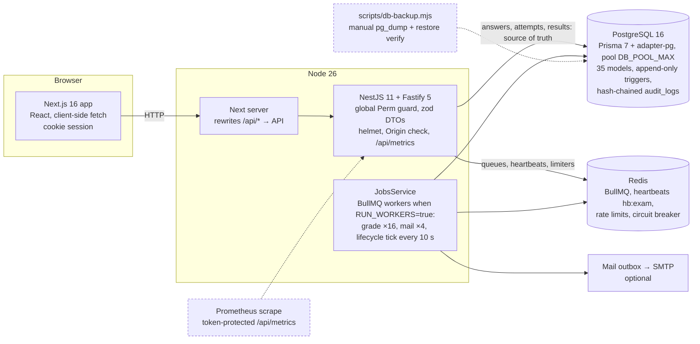

# 03 — Current architecture (as built)

Not present (so not drawn): SSE/WebSocket, object storage (S3 variables exist in `config.ts:14-18` but nothing uses them), reverse proxy/TLS terminator, separate worker deployment, PgBouncer, read replica, error-reporting service, log shipping.

## Inventory (SOURCE, counts TODAY)

- Monorepo: `packages/shared` (permissions, scoring, deadline, digest), `apps/api` (≈ 5.1 k lines of TS excluding generated code across the repo), `apps/web`.
- **Frontend**: Next 16 App Router; 18 route groups under `(app)` + `/exam/[examId]`, `/login`, `/forgot`, `/mfa`, `/verify`. State is local React state + a `session.tsx` context; API client `src/api.ts` (same-origin `/api`, `credentials: same-origin`). **No** `error.tsx`, `not-found.tsx`, `loading.tsx`, `global-error.tsx` anywhere in the tree (TODAY `find`). Security headers set in `next.config.mjs`: `X-Frame-Options`, `nosniff`, `Referrer-Policy`; **no CSP**.
- **Backend modules**: `auth` (login, forgot/reset, TOTP MFA), `org` (institutions, departments, programs, courses, users, students, enrolments, lecturer assignments), `exams` (questions, papers, exams, rosters, eligibility overrides), `delivery` (attempt engine), `invigilation` (monitor, extend, force-submit, incidents), `results` (grading, key actions, approve/publish, certificates), `reports`, `notifications`, `audit`, `metrics`, `health`, `jobs`.
- **Database**: 35 Prisma models (`schema.prisma`); append-only triggers on `answer_events`, `attempt_events`, `audit_logs`, `eligibility_overrides`; frozen paper snapshots in `exam_questions.snapshot`; sequences for certificate serials. Migrations are additive.
- **Transactions**: saves are a single CTE (revision check + upsert + journal); submit is a `FOR UPDATE` tx (`delivery.service.ts:264-330`); publish creates certificates in one tx (`results.service.ts:156-173`).
- **Observability**: hand-written Prometheus metrics, alert rules (`infra/observability/alerts.yml`), runbook. Logging is Nest's console logger; no structured/centralised logging, no error reporter.
- **Deployment**: `docker-compose.yml` and a CI workflow exist but were **never executed** (NOT RUN).

## Weaknesses and unnecessary complexity (evidence-based)

- **One process type, one hidden coupling**: HTTP and lifecycle workers share the codebase; the lifecycle tick is the only mechanism that closes exams and seals expired attempts (`17`/`D-02`). Redis therefore is not "optional" for correctness of *state transitions*, only for saves.
- **Monitor reads are unbounded and fan out per viewer** (`invigilation.service.ts:39-60`).
- **Single database for everything** including the high-write journal (`answer_events` ≈ 1 row/save). Fine at current scale; unpartitioned.
- Microservices are **not** justified by anything measured; the evidence points to query design (monitor, start burst) and deployment topology (separate DB host/pooler), not service decomposition.
