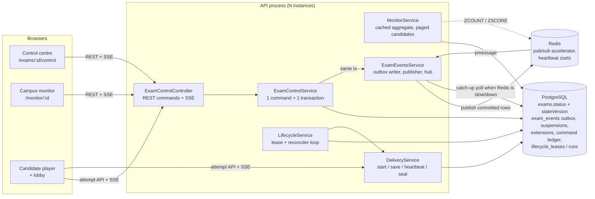

# 01 — Architecture

## What was built (and what was reused)

One exam engine, extended. Nothing in the answer path was replaced: attempts, revisioned saves, idempotent submit, scoring, audit chain, MFA, authorization, campus scoping, eligibility, the Redis circuit breaker and Prometheus metrics are all reused.

## Principles

1. **PostgreSQL is the authority.** The lifecycle state is `exams.status` (+ `stateVersion`). Deadlines are columns on `attempts` evaluated on the database clock. Redis never decides a lifecycle fact.
2. **One command = one transaction**: row lock on the exam → state/precondition checks → guarded updates → version bump + outbox event + hash-chained audit record → idempotency ledger. All commit together or not at all.
3. **The API enforces deadlines and suspensions itself**: the save predicate (`suspendedAt IS NULL AND deadline+grace > clock_timestamp()`), the heartbeat's expiry, the lazy seal on start/heartbeat, and the seal-under-lock re-check. A stopped worker never lets an expired attempt write.
4. **Events are hints, state is read from the database.** Clients treat an event as "ask the server now". Missed events are recovered by cursor replay (`Last-Event-ID`) or a fresh snapshot.
5. **Monitoring cost does not scale with viewers**: one aggregate query per exam per process per ~1.5 s (single-flight cache); per-viewer data is an in-memory filter; candidate rows are paged (≤ 100).

## Components

| Component | File | Role |
|---|---|---|
| State machine | `control/exam-state.ts` | Command table: allowed states, preconditions, deadline/candidate effects, audit, idempotency |
| Commands | `control/control.service.ts` | 9 commands + policy + read model |
| Outbox + hub | `control/events.service.ts` | Same-tx events, Redis publish (bounded retries), SSE fan-out, DB catch-up |
| Reconciler | `control/lifecycle.service.ts` | Lease, auto-submit, auto-start/close, scoring, backlog recovery, health |
| Monitor | `control/monitor.service.ts` | Snapshot, paged candidates, connection state from Redis zsets |
| HTTP | `control/control.controller.ts` | REST + SSE endpoints |
| Delivery changes | `delivery/delivery.service.ts` | Start gating, sync clock, suspended predicate, `sealIfExpired`, heartbeat state |
| Audit | `audit/audit.service.ts` | `append(tx)`: audit in the caller's transaction |

## Removed

The Redis/BullMQ sweeper (`QUEUES.sweep`, `ResultsService.tick`). BullMQ remains only for grading and mail (accelerators; the reconciler also grades from the database).

## Scope and honest limits

Unchanged and not addressed here: answer keys in plaintext at rest, single-region single-database topology, no PgBouncer. See `11-known-risks.md`.
