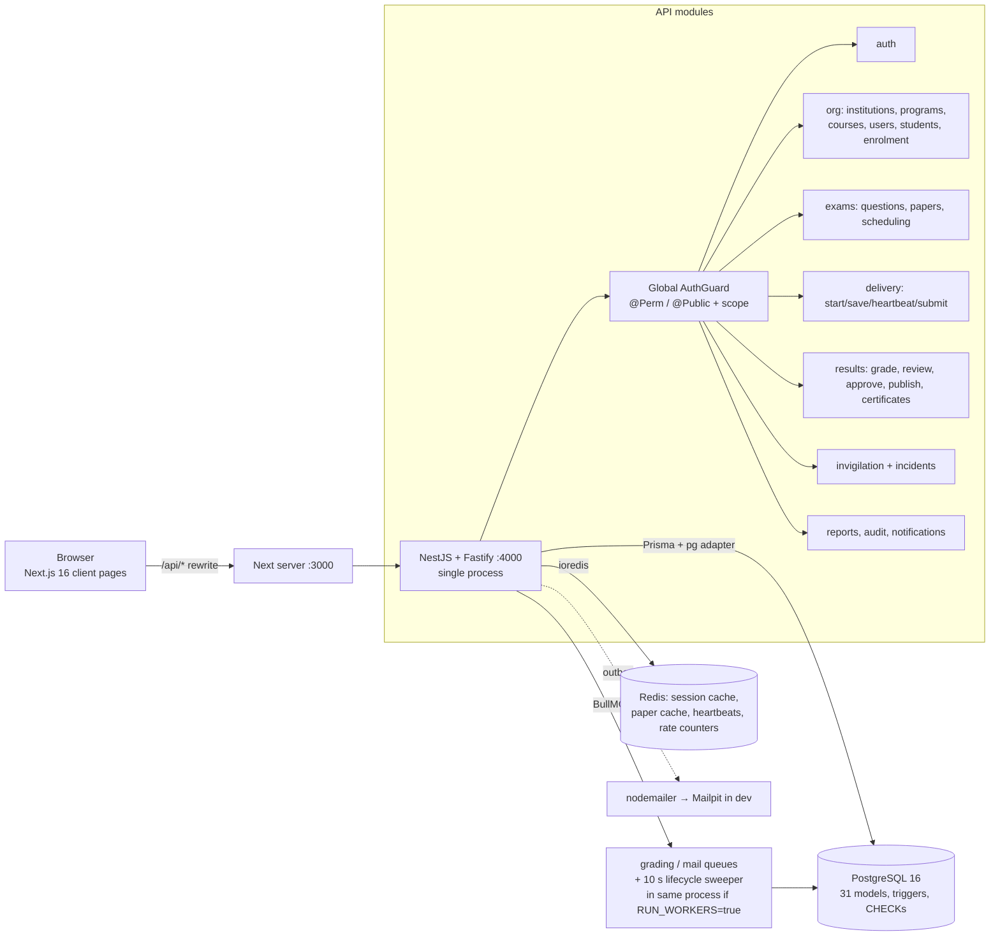

# 03 — Current Architecture (as implemented, not aspirational)

**Not present in code:** object storage client, WebSocket/SSE, PgBouncer, read replicas, metrics/tracing exporters, backup jobs, SMS provider, separate worker deployment (workers share the API process via a flag).

## Layers
- **Frontend:** App Router client components; auth via HttpOnly cookie (`session.tsx`); `api.ts` fetch wrapper; role-aware nav (`nav.ts`); exam player drives `exam-engine.ts` (per-question revision, retrying save queue, offline recovery, server-offset clock, 15 s heartbeat, localStorage as crash buffer only).
- **Backend:** Controller → zod `parse()` → service → Prisma/raw SQL. Deny-by-default global guard; permissions matrix in `packages/shared`; campus scope helpers (`scope.filter/allows/assert`, out-of-scope ⇒ 404). Errors normalised by `AllExceptionsFilter`.
- **Data:** Prisma for CRUD; raw SQL only in hot paths (save upsert CTE, attempt claim, audit lock). Triggers make `audit_logs`/`answer_events` append-only and lock `attempt_answers` once the attempt is not `IN_PROGRESS`.
- **Time:** all deadline logic uses DB `clock_timestamp()`; client clock only for display.

## Recommended target vs gap
| Target | Gap |
|---|---|
| API ×N behind LB, stateless | Process model untested beyond 1; sweeper must be leader-elected/idempotent (uses DB predicates, but not load-verified multi-node) |
| Dedicated worker deployment | Workers co-located flag only |
| PgBouncer (txn mode) + tuned pool, PG with PITR backups | Neither exists; Prisma `$queryRaw` usage must be checked for prepared-statement compatibility |
| Redis HA / Sentinel | Single instance; session cache falls back to DB (V by design, **fail-open behaviour of rate limiter U**) |
| S3 for materials/certificates | No adapter |
| SSE/WS for monitor | Polling |
| Observability (Prometheus, structured logs, alerts) | Nest logger only |
| Partitioned `answer_events` | Single table with index; will reach tens of millions of rows at target scale |
