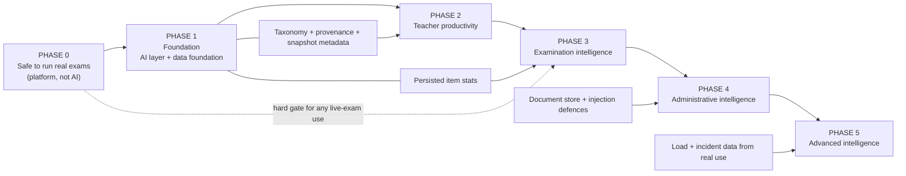

# SZABMU OES — AI Implementation Roadmap

Date: 2026-11-07 · Companion to `SZABMU-OES-INFRASTRUCTURE-AND-AI-READINESS-AUDIT.md` (cited as "the audit"; finding IDs such as DB-02 refer to it and to `docs/audits/audit-evidence/`).
Status: **PROPOSAL.** Nothing here is built. All effort figures are **estimates** for a small team (1–2 engineers who know the codebase), in person-weeks (pw), and exist only to compare options; they were not derived from measurement. No provider prices were looked up.

## 1. Principles

1. **Platform before features.** A feature is only as trustworthy as the data and controls under it (audit §1, §17).
2. **AI assists, humans decide.** Every AI output is a suggestion that enters the existing review workflow. AI never changes marks, eligibility, exam state or publication, and never accuses or penalises a candidate.
3. **Deterministic first.** If rules, statistics or a SQL query solve it, do not call a model.
4. **Simplest architecture.** One `ai` module inside the existing NestJS application; external hosted model behind a provider interface; no microservice, no self-hosted model, no model tools.
5. **Off by default.** Per-feature flags, kill switch, quotas, evaluation gates, written approval before any data leaves the system.
6. **Do not weaken access controls.** The AI context builder inherits the caller's scope; teachers still never receive results or marks.

## 2. Roadmap overview

Only **Phase 0** and the **data-foundation half of Phase 1** are on the critical path to *any* AI work. Phases 2–3 may overlap once Phase 1 exits.

## 3. Prioritization matrix

Value and feasibility 1–10. Complexity/security risk/cost: L/M/H. Effort: person-weeks (estimate, excluding Phase 0/1 prerequisites unless stated). "Det." = no model needed.

| ID | Feature | Value | Feas. | Complexity | Security risk | Op. cost | Depends on | Effort (pw) | Phase |
|---|---|---|---|---|---|---|---|---|---|
| P0-x | Platform safety work (audit §17, items 1–8) | 10 | 9 | H | — | M | — | 10–16 | **0** |
| F-01 | AI foundation: `ai` module, provider interface, flags, quotas, `ai_requests`/`ai_suggestions`, kill switch, eval harness, outbound-HTTPS check | 9 | 8 | M | M | L | Phase 0 items 2, 3 | 4–6 | **1** |
| F-02 | Topic/learning-outcome taxonomy per course; controlled vocabulary on all authoring paths; fix DOM-01 (admin path metadata, topic nulling) | 9 | 8 | M | L | L | — | 3–5 | **1** |
| F-03 | Provenance field + paper snapshot metadata + `questionVersion` on `exam_questions` (DB-15) | 8 | 9 | L | L | L | — | 1–2 | **1** |
| F-04 | Persisted item statistics (`question_item_stats`), DB-05 fix, distractor/discrimination tables (**Det.**) | 9 | 8 | M | L | L | F-03 | 3–4 | **1** |
| F-05 | Extend duplicate detection and item-writing rules to the teacher portal (**Det.**) | 7 | 9 | L | L | L | permission change for TEACHER scope | 1–2 | **1** |
| A1 | Teacher MCQ drafting (topic / approved text) | 9 | 8 | M | M | M | F-01, F-02, F-03, F-05, provider approval | 4–6 | **2** |
| A2 | Distractor generation and wording/clarity improvement | 8 | 8 | L | M | L | A1 pipeline | 1–2 | **2** |
| A3 | Bloom and topic/outcome tagging suggestions | 8 | 7 | M | L | L | F-02 | 2–3 | **2** |
| A7 | Explanation drafting (author-edited) | 6 | 8 | L | L | L | A1 pipeline | 1 | **2** |
| A6 | LLM question-quality warnings (ambiguity, possible 2nd correct option, key doubt) | 8 | 6 | M | M | M | A1, F-05, eval harness | 3–4 | **3** |
| B1 | Paper blueprint and coverage assistant (**mostly Det.**) | 9 | 7 | M | L | L | F-02, F-03, F-04, FE-04 fix | 4–5 | **3** |
| B2 | Alternative paper versions; difficulty-distribution comparison | 7 | 7 | M | M | L | B1 | 2–3 | **3** |
| C1 | Analytics dashboards: item, topic, cohort, campus, trends (**Det.**), admin-only | 8 | 8 | M | L | L | F-04 | 3–4 | **3** |
| C2 | LLM prose interpretation of statistics (labelled "interpretation") | 5 | 7 | L | L | L | C1 | 1 | **3 (optional)** |
| D2 | Operational digests: pending approvals, registrations, schedules, incomplete configurations (**Det.**) | 7 | 9 | L | L | L | — | 2–3 | **4** |
| D1 | Natural-language admin assistant over fixed, read-only, permission-scoped tools | 7 | 5 | H | H | M | D2, F-01 | 5–8 | **4 (conditional)** |
| E1 | Document ingestion: syllabus/outcome extraction with human confirmation | 8 | 5 | H | H | M | document store, upload pipeline, injection corpus, F-02 | 6–10 | **4 (conditional)** |
| E2 | Institutional knowledge retrieval (RAG) | 6 | 4 | H | H | M | E1 | 4–6 | **4 (conditional)** |
| F1 | Student help assistant over static help text | 4 | 8 | L | M | L | none; never during restricted exams | 2 | **4 (optional)** |
| G2 | Operational / audit-log anomaly indicators (explainable, no student labels) | 6 | 6 | M | M | L | alerting from Phase 0 | 3–4 | **5** |
| G1 | Exam-security indicators on sessions (rule-based, human review only) | 6 | 6 | M | **H** | L | FE-01 (richer events), policy approval, evidence standard | 4–6 | **5 (conditional)** |
| H1 | Operational forecasting (load, grading time) | 4 | 5 | M | L | L | real load data | 2–3 | **5** |
| — | Student risk prediction / cheating ML (G3), biometric or emotion analysis, AI marking, student assistant over personal data (F2) | — | — | — | **H** | — | — | — | **Do not build** |

## 4. Phases in detail

### Phase 0 — Make the platform safe to run real exams (not AI)
Why here: AI features would sit on top of a result and deployment pipeline that is not yet trustworthy (audit §1, §17). None of this is optional for a real exam, with or without AI.

| Work item | Findings | Exit evidence |
|---|---|---|
| Staged load test on the real Hostinger plan and database (scenarios L0–L12, `docs/audits/audit-evidence/03-hosting-and-scalability.md` §6); set cohort size and start-stagger limits from results; verify DB isolation level, connection quotas, SSE through the edge, outbound HTTPS | OPS-01, OPS-10, OPS-11 | Recorded results; cohort limit documented; targets met with 30 % headroom |
| Decouple deploy from `main` (required CI, release branch/tag, deploy-freeze flag, migrations as a separate observable step) | OPS-02, OPS-12 | A merge during a freeze does not restart production |
| Mandatory production mode in the launcher; refuse seeded accounts on non-demo data; rotate/disable demo accounts | OPS-03, SEC-01 | Boot fails on a weak or demo configuration; checked in CI |
| Database result integrity: triggers on `results`, `result_batches`, `key_actions`, approved `exam_questions`, `certificates`; result-set digest in the publish audit entry; scoring-version stamp | DB-02, SEC-03 | Direct `UPDATE` after publish is refused; tested |
| Atomic, resumable key-correction regrade as a background job; review/approve blocked while behind; correct item-analysis key | DB-01, DB-05, OPS-16 | Kill the process mid-regrade → resumes and completes; tests |
| Withhold/void paths excluded from publish and certificates | DB-03, DB-18 | Tests; policy decision recorded |
| Scheduled, encrypted, off-site backups; pre-open/post-close dumps; monthly verify; restore rehearsal into a fresh Hostinger database with timing (RTO) | DB-04, OPS-08 | Rehearsal report with elapsed time |
| External uptime/synthetic checks; deep health (lifecycle age, expired backlog, pool wait, event-loop lag); alert rules including lifecycle; on-call route | OPS-09, OPS-04, DB-10 | Forced stall triggers an alert within 2 minutes |
| Estimated effort: **10–16 pw** across the items above | | |

**Phase 0 follow-ups (P1, may overlap with Phase 1):** gate and audit full-paper/key reads (SEC-02); fail-closed security counters (SEC-05); MFA for lecturers and invigilators and safer first enrolment (SEC-06); teacher dashboard default (SEC-07); remove per-login rows from the global audit lock, jitter SSE heartbeats, NAT-aware login limits (OPS-05/06/07); make the cron backstop real (OPS-04); paper-builder pager and `/auth/me` failure handling (FE-04, FE-05); image delivery to candidates (DB-13).

### Phase 1 — Foundation (AI layer and data foundation)
Two independent tracks that can run in parallel.

**Track A — AI foundation (F-01).**
- `ai` module: controller (`ai.assist` permission), service, provider interface (one concrete adapter, one fake for tests), prompt templates versioned in code, zod output schemas.
- Tables: `ai_requests` (feature, user, provider, model, template version, token counts, latency, cost, input hash, outcome — no confidential text), `ai_suggestions` (candidate payload, state, decision, decided-by/at).
- Controls: per-feature flags (default off), per-user and global quotas, monthly spend cap with automatic disable, kill switch, `productionProblems()` extended to refuse boot if a flag is on without approval variables.
- Execution: persisted job rows processed by the lifecycle pass (survives restarts); no model call on any candidate-facing request path.
- Evaluation harness: golden prompts, injection corpus, scope tests, "AI down" tests (audit §19).
- Verify outbound HTTPS from the Hostinger site to the chosen provider (egress, TLS, timeout).

**Track B — Data foundation (F-02 … F-05).**
- Course-level `Topic` and `LearningOutcome` tables; `Question.topicId`; migrate free-text topics with a reviewed mapping; controlled vocabulary on **both** authoring paths; stop nulling topic on edit (DOM-01).
- `source` provenance on `questions`/`question_versions`; `questionVersion` and metadata snapshot on `exam_questions` (DB-15).
- `question_item_stats` and corrected item analysis (DB-05); distractor tables by upper/lower group.
- Make the rule checks and duplicate detection available to teachers (DOM-10) — a scoped, read-only permission for TEACHER limited to their own course bank.

**Phase 1 exit criteria.**
1. Provider approved in writing by the Controller of Examinations; DPA on file; data classes permitted recorded.
2. Provider call works from the deployed site; contract tests pass against the fake; kill switch tested.
3. Every new question on every path has a topic (or an explicit "unclassified" state) and provenance.
4. Item statistics persist for at least the seeded exams; analysis matches effective keys.
5. Governance register (`docs/ai/`) updated: feature owner, risk tier, data classes, evaluation owner.
- Estimated effort: Track A **4–6 pw**; Track B **8–13 pw**.

### Phase 2 — Teacher productivity
Work items: A1 drafting, A2 distractors/wording, A3 Bloom/topic suggestions, A7 explanation drafting.

Workflow (unchanged review path): teacher selects subject + topic → context builder assembles an approved excerpt within the teacher's assignment and term → queued job → provider → schema validation → rule checks and duplicate check → **suggestions** → teacher edits and accepts → normal DRAFT question with `source=AI_ASSISTED` → teacher submits → examiner reviews (four-eyes, mandatory notes).

Gates to enable per department (pilot one first):
- Expert panel review of a sample (proposal: ≥ 100 generated items across at least two subjects) rating accuracy, relevance, distractor plausibility, clinical safety, bias. **Thresholds are set by the examiners before the pilot**, not after.
- Acceptance rate, edit distance, rejection reasons, and sampled factual-error rate reported weekly.
- No confidential bank text in prompts unless approved; verify by test.
- Estimated effort: **8–12 pw** including UI panel work in the dense pool editor (FE-03).

Success measures (proposal): reduction in time to produce an approved item (measured by timestamps already in the review workflow), share of AI-assisted items approved without rewrite, and — critically — no increase in post-exam key corrections (`key_actions`) for AI-assisted items versus others.

### Phase 3 — Examination intelligence
Work items: B1 blueprint/coverage, B2 alternative versions and comparison, C1 analytics, A6 LLM quality warnings, optional C2 interpretation.

- B1 is mostly deterministic: coverage by topic/Bloom/difficulty against a blueprint; marks/counts; repetition across recent papers; structure validation. It reads only `APPROVED` banks, never schedules or publishes.
- A6 warnings are displayed separately from rule findings and from human decisions, and labelled "warning — not verified".
- C1 is admin-only. Teachers receive no results, marks or student-level analytics. Descriptive statistics are shown as numbers; any model-written prose is labelled "interpretation".
- Estimated effort: **12–17 pw**.
- Exit: examiner acceptance of blueprint reports on at least one real paper cycle; analytics reproduce hand-computed values on a sample.

### Phase 4 — Administrative intelligence
- **D2 first** (deterministic digests): pending teacher registrations, exams next week, campuses with incomplete configuration, subjects with too few approved MCQs.
- **D1 conditional:** a natural-language front-end over those same permission-checked services (fixed tools, read-only, no raw SQL, no write tools). Any state change is proposed and then done by the human in the normal UI flow with the usual confirmation.
- **E1/E2 conditional:** document ingestion and retrieval only after: a storage decision (not DB BLOBs at scale, DOM-08), upload validation and scanning decision, source attribution on every extracted item, human confirmation of every extracted topic/outcome, and a passing prompt-injection corpus.
- **F1 optional:** student help over static help text, never during restricted exams, no personal data.
- Estimated effort: D2 **2–3 pw**; D1 **5–8 pw**; E1+E2 **10–16 pw**; F1 **2 pw**.

### Phase 5 — Advanced intelligence (only with evidence and approval)
- G2 operational and audit anomaly indicators (no student labels) — **3–4 pw**.
- G1 session-level indicators — only with explainable rule-based indicators, an evidence standard, institutional authorization and mandatory human review; client must first emit richer events (FE-01). **4–6 pw.** No automatic consequence of any kind.
- H1 forecasting from real load data — **2–3 pw**.
- Each item requires a written risk assessment and a separate go/no-go.

## 5. Recommended first three AI features

| Order | Feature | Why first | Prerequisites |
|---|---|---|---|
| 1 | **Teacher MCQ drafting assistant** (A1, with A2/A7 reusing its pipeline) | Highest value for the least new risk: output is a draft entering the existing four-eyes review; no student data; reuses approval primitives | Phase 0 (items 2, 3, 8), F-01, F-02, F-03, F-05, written provider approval |
| 2 | **Question-quality and classification assistant** (A3 + A6 on top of the existing deterministic checks) | Improves the bank the first feature fills; Bloom/topic tags unlock coverage analysis | Taxonomy (F-02); A1 pipeline; evaluation harness |
| 3 | **Paper blueprint and coverage assistant** (B1) | Direct examiner value; mostly deterministic, so low risk; consumes taxonomy, snapshot metadata and persisted statistics | F-02, F-03, F-04, FE-04 fix |

Not on this list on purpose: the student assistant (low value, personal-data risk) and any anomaly or risk model (high risk, little data, policy undecided). The deterministic analytics (C1) are arguably higher value than any LLM feature and should ship alongside the third item.

## 6. Dependency and sequencing summary

1. Phase 0 items 1–3 (load test, deploy decoupling, production mode) → unblock everything that touches production.
2. Phase 0 items 4–8 (integrity, regrade, withhold, backups, alerting) → gate any real exam and any analytics that publish to users.
3. Phase 1 Track B (taxonomy → provenance/snapshot → item stats) → gate A3, B1, C1.
4. Phase 1 Track A (AI layer) in parallel → gates A1.
5. Provider approval and DPA (organizational, can start now) → gates the first outbound call.
6. Phase 2 pilot (one department) → evaluation gate → wider enablement.
7. Phase 3 after Phase 2 evaluation; Phase 4 after document-store and injection defences; Phase 5 only with real data and approvals.

Indicative elapsed time with 1–2 engineers (ESTIMATE): Phase 0 ≈ 2.5–4 months; Phase 1 ≈ 2–3 months (parallel tracks); Phase 2 ≈ 2–3 months including the pilot; Phase 3 ≈ 3–4 months. Phases 4–5 are decision-gated rather than scheduled.

## 7. Decisions required from the institution (blockers outside engineering)

1. Which provider/model, in which region, under what DPA; what data classes may leave (default: syllabus text only).
2. Visibility of other authors' draft questions to examiners/lecturers (DOM-02).
3. Result withhold and void policy; appeal window (DB-03).
4. Retention and anonymisation schedule (DB-12).
5. Who may read full papers and keys, and when (SEC-02).
6. Whether student-facing help is wanted at all, and under what exam-time rules.
7. Whether MFA becomes mandatory for lecturers and invigilators (SEC-06).
8. The monthly AI spend cap and the owner of the AI register.

## 8. What would change this roadmap

- Load tests on Hostinger miss their targets → move the API to an external managed container platform before Phase 3; AI work is unaffected because it is asynchronous.
- Provider approval is refused → Phases 2–3 continue with deterministic features only (F-04, F-05, B1, C1, D2) — these already deliver most of the operational value.
- A syllabus document store is approved early → Phase 4 document work can move up, but only after the injection defences exist.
- Real misconduct evidence requirements are defined by the university → Phase 5 G1 can be scoped; until then it stays out.
