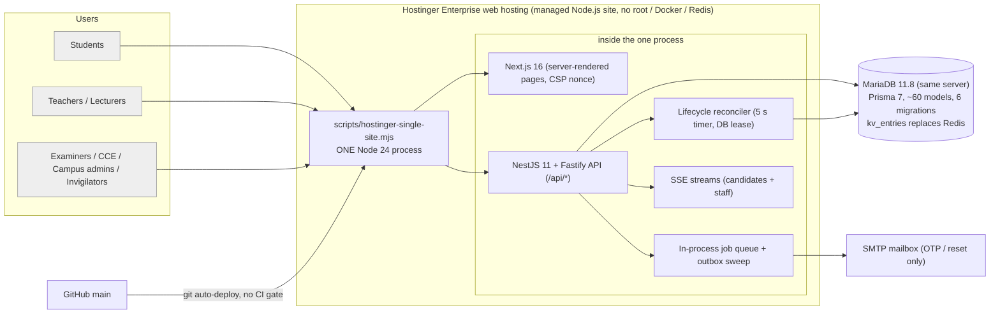
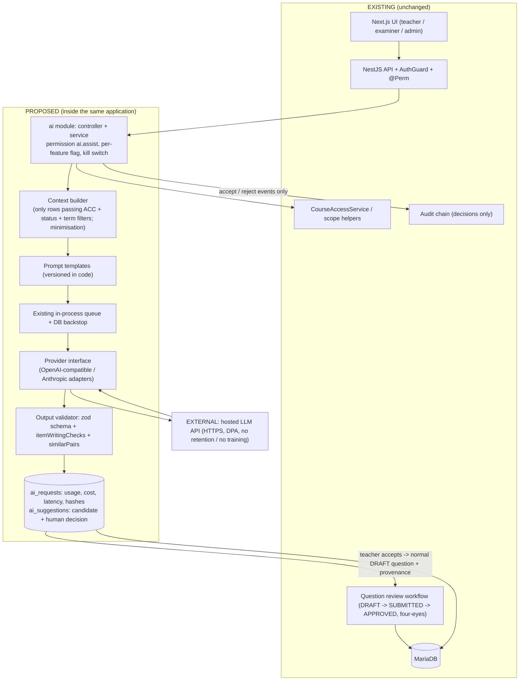

# SZABMU OES — Infrastructure Audit and AI-Readiness Assessment

Date: 2026-11-07 · Repository state audited: `main` at `144149f` · Companion document: `SZABMU-OES-AI-IMPLEMENTATION-ROADMAP.md`
Detailed per-finding evidence: `docs/audits/audit-evidence/01…05-*.md` (cited below as E1–E5).

## 0. How to read this report

**Method.** Five independent read-only reviews (security; exam engine and database; hosting and scalability; frontend; domain workflows and AI-readiness data) read the source, schema, migrations, launcher, CI and tests. The lead auditor then merged the results and re-checked the claims that drive the headline conclusions directly in code. **Nothing was executed**: no server, test, build, load test, database query or request against the live site. No production code, dependency or configuration was changed. No AI dependency was added.

**Evidence tags.**
- **VERIFIED** — the reviewer read the cited file and line and it shows what is claimed.
- **RE-CHECKED** — VERIFIED by the reviewer *and* confirmed again by the lead auditor (listed in §0.2).
- **ASSUMPTION** — depends on a deployment fact or runtime behaviour not visible in the repository. Every ASSUMPTION is listed in the "could not verify" sections of E1–E5 and in §18.
- **PROPOSAL** — a recommendation or estimate, not a fact.

**Severity.** CRITICAL / HIGH / MEDIUM / LOW / INFORMATIONAL. Reviewer severities are kept, with one calibration: the hosting reviewer rated OPS-02 (auto-deploy of `main` to the only production process) CRITICAL; I rate it **HIGH** because no real examination is live (the product is `INTERNAL_TESTING_READY`), and the exposure is controlled by process. It becomes CRITICAL the day a real exam is scheduled. OPS-01 (no capacity evidence on the target host) stays **CRITICAL as a release blocker**, not as a present incident.

**Totals (103 findings).** CRITICAL 1 · HIGH 15 · MEDIUM 35 · LOW 37 · INFORMATIONAL 15 (after the OPS-02 calibration).

### 0.1 Limits of this audit
- Static review only. Every performance statement is either a quoted local measurement from the repo's own documents or a reasoned estimate, marked as such. **No benchmark was fabricated.**
- The live Hostinger configuration (environment variables, DB isolation level, `max_user_connections`, edge timeouts, SSE buffering, backups, accounts present) is not readable from the repository. All statements about it are ASSUMPTIONS.
- Not run: tests, axe, bundle analysis, dependency vulnerability scan (`npm audit` advisories were reported as untriaged in `docs/security.md`), contrast calculations, nginx config validation.
- Lines are cited as `path:line` at commit `144149f`; they drift as code changes.

### 0.2 Claims re-checked directly by the lead auditor
| Claim | Result |
|---|---|
| DOM-02: `GET /questions` shows other authors' drafts and the key | Confirmed: `questions.service.ts:60-72`, `course-access.service.ts:36-42` (`{}` for unrestricted roles; no status/author filter) |
| DOM-04: `RosterEntry.claimedAt` never written | Confirmed: only reads in `registration.service.ts:122-127` |
| DB-02: no trigger on `results`/`certificates` | Confirmed: no such trigger in any migration |
| DB-03: `WITHHELD` / attempt `VOID` never set | Confirmed by grep of `apps/api/src` |
| OPS-03 / SEC-01: API started as `NODE_ENV=development` | Confirmed: `scripts/hostinger-single-site.mjs:27` (`API_NODE_ENV` default `development`); `productionProblems()` runs only in production mode (`config.ts:59`, `:93`) |
| SEC-02: full paper + key readable at any exam state | Confirmed: `exams.controller.ts:46` (`question.read`), `exams.service.ts:76-82` (no status condition) |
| SEC-05: rate limits fail open | Confirmed: `kv.service.ts:54-59, 77-92` (`hit()` returns 0 on error) |
| SEC-06: MFA roles | Confirmed: `common/auth.ts:26` (4 roles) |
| SEC-07: teacher receives university totals | Confirmed: `reports.service.ts:78` `default:` branch; `permissions.ts:15` gives `program.read` to TEACHER |
| SEC-01: demo password published | Confirmed: `README.md:24` |

---

## 1. Executive summary

**Verdict.** SZABMU OES is a genuinely careful piece of engineering at its core. The candidate-facing exam path — server-side deadlines on the database clock, transactional and idempotent answer saves, seal-once submission with receipts, a key that never reaches candidates, deny-by-default authorization with one permission per route, campus isolation, hash-chained audit log — is well designed and consistently implemented. I found **no CRITICAL or HIGH defect in answer persistence, timing or candidate-side confidentiality**.

The platform is **not ready for a high-stakes production examination**, for reasons that are mostly outside that core:

1. **Nothing proves it works on the real host at the intended scale** (OPS-01). All load evidence is from a local 4-vCPU machine with the database on localhost; even there, a 5,000-candidate start inside 10 s gave a start p50 of about 11 s. The documented 20,000-candidate design goal is unsupported.
2. **Result integrity is enforced by application discipline, not by the database** (DB-02, SEC-03): no triggers on `results`, `key_actions` or `exam_questions`; a key correction is a non-atomic, non-resumable regrade loop (DB-01); there is no way to withhold a result or void an attempt (DB-03).
3. **Operations are fragile for a single-process, single-database topology on Hostinger**: every push to `main` redeploys and restarts the only process (OPS-02); the production safety gate is bypassed by the launcher (OPS-03/SEC-01); backups are manual, unencrypted, and never restored to the target (DB-04/OPS-08); there is no alerting (OPS-09).
4. **Exam-day serialization points**: every login takes a global audit-chain lock plus an argon2 hash (OPS-05); a 60-per-IP login limit will lock out campus NAT labs or be bypassable (OPS-06); one control event makes every client send a heartbeat at once (OPS-07).
5. **Confidentiality of the answer key rests on people** (SEC-02): any lecturer assigned to a course can read the approved paper and key at any time, including during the sitting, with no audit trail.

**AI readiness.** There is **no AI code, key, prompt or provider anywhere** (RE-CHECKED; E1 SEC-20, E5 DOM-12). The repository already contains an AI governance baseline (`docs/ai/*`) and three *deterministic* assistive tools — item statistics (`packages/shared/src/psychometrics.ts`), duplicate detection (`similarity.ts`), item-writing rules (`item-writing.ts`) — whose existence the reviewers verified in code. The human-approval primitives an AI feature needs (draft → submitted → approved/rejected, four-eyes, mandatory rejection notes, append-only question versions) **already exist and can be reused unchanged**. What is missing is the data foundation: no syllabus, learning-outcome or topic taxonomy (DOM-03), inconsistent topic/Bloom labelling by author role (DOM-01), frozen paper snapshots without question version or metadata (DB-15), no stored item statistics, and no provenance field.

**Recommendation in one paragraph.** Do not start by building AI features. First (a) close the integrity and operations gaps that would make *any* feature unsafe on a live exam (§17, items 1–10), (b) build the data foundation (topic taxonomy, metadata consistency, provenance, persisted item statistics), then (c) add AI as a small, optional, flag-gated module **inside the existing NestJS application**, calling an external hosted model through a provider interface, producing only *drafts and suggestions* that enter the existing review workflow. Start with teacher MCQ drafting, question-quality assistance and paper-blueprint assistance. Defer student-facing and anomaly-detection AI until policy approvals and evidence exist. Self-hosted models are not feasible on this hosting plan.

---

## 2. Existing architecture overview

**Facts (E3 §1, VERIFIED).** One long-lived process serves Next.js and the API on one port; `/api/*` is routed in-process to Fastify. With `REDIS_URL` unset the code uses a database-backed key-value store (`kv_entries`, `attempt_heartbeats`), an in-process queue and an in-process pub/sub with a 2-second database catch-up poll. Background progression (open/close exams, seal abandoned attempts, grade, mail retry) runs on timers in the same process under a database lease. A finite `npm run reconcile` backstop exists but is **not scheduled**. There is no object storage; photos and question images are database BLOBs. Mail is SMTP for OTP/reset only.

**Stack.** Node ≥ 24; NestJS 11 + Fastify; Prisma 7 on MariaDB (MySQL provider); Next.js 16.4.3 / React 19 (App Router, 38 of 39 pages are client components); shared TypeScript package `@oes/shared` for permissions, exam rules, psychometrics, similarity, item-writing rules; Vitest (53 API test files), Playwright (52 e2e spec files) and a fault-injection suite; one GitHub Actions workflow (`verify` on Node 26 + Redis; `node24` without Redis).

---

## 3. Module inventory

All API modules live in one flat Nest `AppModule` (E5). Lines are `.ts` lines in the folder.

| Module (`apps/api/src/…`) | Purpose | Lines | Status |
|---|---|---|---|
| `modules/auth` | login, MFA/TOTP, password reset, student sign-up, onboarding, roster import | 694 | Works; roster "claimed" tracking dead (DOM-04) |
| `modules/teachers` | teacher sign-up, workspace, question pools, bank review, admin approvals | 1034 | Works end to end |
| `modules/org` | institutions, programmes/courses, users, students, enrolments, course access | 538 | Works; department routes have no UI |
| `modules/exams` | question bank, paper build/approve, exam create/schedule, roster versions, overrides | 521 | Works; admin-path metadata gap (DOM-01) |
| `modules/control` | live exam control, lifecycle reconciler, monitor, SSE/outbox | 1232 | Works; see DB-09/10, OPS-04/07 |
| `modules/delivery` | candidate start/save/heartbeat/submit/receipt | 511 | Works; strongest part of the system |
| `modules/results` | grading, key actions, item analysis, review chain, publish, certificates | 240 | Works; DB-01/02/03/05/06/07 |
| `modules/invigilation` | live monitor, incidents, extensions | 155 | Works |
| `modules/reports` | dashboard, exam report/CSV, audit list/verify, notification routes | 191 | Partial (broadcast/institution reports have no UI) |
| `modules/notifications` | in-app notifications only | 30 | In-app only |
| `modules/audit` | SHA-256 hash-chained audit log | 73 | Works; SEC-04, DB-21 |
| `modules/directory` + `src/directory` | institution/programme directory, importer, rollback | 221 + 848 | Works; `reassign-students` has no UI |
| `jobs.service.ts`, `cron/`, `worker.ts` | queue consumers, outbox sweep, reconcile backstop | ~80 | Works; cron backstop not scheduled |
| `infra/` | DB pool/URL, KV, queues, mail, metrics | 671 | Works |
| `seed/` | demo data | — | Dev only |
| `apps/web` | 39 pages, no mock/placeholder pages found (E4) | — | 38 of 39 client components |

**Implemented / partial / placeholder / unused (E4, E5).**
- *Placeholders or mock pages:* none found; every frontend call extracted matches a real controller route.
- *Backend features with no UI:* MFA disable/reset, notification broadcast, department routes, `directory/reassign-students`, `reports/institutions`, `grading/exams`, roster-version and eligibility-override viewers (FE-10, DOM-06).
- *Unused/dead:* `QUEUES.results`; S3 settings and `@aws-sdk/client-s3` (no client use in `apps/api/src`); `Result.adjustment` column; `WITHHELD`/`VOID` enum states; `RosterEntry.claimedAt` write; three of six integrity event kinds on the server.
- *Duplicates:* two faculty models (LECTURER vs TEACHER) and two question-authoring DTOs/services with different validation and term scoping (DOM-07).

---

## 4. Frontend architecture findings (E4)

Next 16.4.3, React 19.3.1, TypeScript 5.9.3, App Router, `src/proxy.ts`. Zero third-party UI or data libraries. Hand-written fetch wrapper (`api.ts`), `useGet` hook, SSE helper. Cookie-based auth with no token in JS-readable storage. 39 pages; every page is in at least one portal allow-list (checked by a test).

**Integration of student portal and admin dashboard.** One build, served by host-based portal resolution. Pages outside a portal's list are rewritten to a 404. The separation is also expressed in the API (`PORTAL_ENFORCE`), but see FE-02 and SEC-01.

| ID | Sev | Finding | Evidence |
|---|---|---|---|
| FE-01 | MEDIUM | Client emits only `TAB_HIDDEN`, `ONLINE`, `OFFLINE`; server also accepts `FULLSCREEN_EXIT`, `PASTE_BLOCKED`, `TAB_VISIBLE` which are never sent; the benchmark doc claims "fullscreen exit" evidence | `exam-engine.ts:55,79`; `delivery.controller.ts:24`; `GLOBAL_EXAM_PLATFORM_BENCHMARK.md:34` |
| FE-02 | MEDIUM | Portal separation **fails open** if neither `PORTAL` nor `PORTAL_FROM_HEADER=true` is set | `proxy.ts:16-17` |
| FE-03 | MEDIUM | Oversized, extremely dense pages (exam player 38.6 KB; 221 lines > 300 chars); `any` pervasive; copy-paste of image viewers/import dialogs/filter bars | `exam/[examId]/page.tsx`, `pools/page.tsx`, `exams/[id]/page.tsx` |
| FE-04 | MEDIUM | Paper builder fetches `pageSize=200` of the bank with no pager — silently truncates larger banks | `exams/[id]/page.tsx:17` |
| FE-05 | MEDIUM | Any `/auth/me` failure (network, 5xx) is treated as signed-out and redirects to `/login` — a candidate reloading during an outage is bounced | `session.tsx:21,29` |

LOW/INFO: FE-06 session-expiry event on a save 401 unmounts the player; FE-07 answer buffer in localStorage not user-scoped; FE-08 `role="radio"` without arrow-key behaviour; FE-09 nav drawer has no focus trap; FE-10 backend endpoints with no UI; FE-11 no GET retry/caching, notification poll runs while tab hidden; FE-12 header set good but no `Permissions-Policy`/CSP reporting; FE-13 external source link without scheme check; FE-14 candidate player renders text only, no question images (see DB-13); FE-15 images as base64 in JSON; FE-16 no dark mode, contrast not computed.

**Verified strengths (E4 §4).** Strict per-request nonce CSP without `unsafe-inline`/`eval` in production; no `dangerouslySetInnerHTML`; no open redirect (`isSafeAppLink`); an exam client that treats the server clock and deadline as truth, uses monotonically increasing revisions, retries with jittered backoff, reconciles ambiguous saves against `/sheet`, protects double submit, and survives reload; error boundaries at three levels; skip link, labelled fields, focus-trapping modal, keyboard-reachable scrolling tables, responsive cards; spreadsheet import hardened against zip bombs and formula injection.

---

## 5. Backend architecture findings

**Shape (VERIFIED).** NestJS 11 on Fastify; one flat module; global `AuthGuard` that **denies any handler without `@Perm` or `@Public`** (`common/auth.ts:104`), confirmed by a controller-by-controller scan; zod validation on bodies/queries with length and array caps; UUID params via `ParseUUIDPipe`; 2 MiB body limit; Helmet; no CORS plugin (same origin). Services contain business logic; controllers are thin. Transactions are used for the exam-critical paths (save, seal, publish, state transitions). Errors are mapped centrally and do not leak SQL.

**Gaps.**
- *API versioning:* routes are unversioned (`/api/...`); no `/v1` prefix was observed in any cited route. ASSUMPTION that there is no versioning mechanism elsewhere. For a system that will gain AI endpoints and external clients this is a LOW-priority but real constraint.
- *Rate limiting:* only login, forgot-password, registration, MFA, public certificate verify, answer-save and integrity events are limited (OPS-18); counters fail open when the store errors (SEC-05); the per-IP login limit conflicts with campus NAT (OPS-06).
- *Background processing:* in-process queue lost on restart; DB backstops exist for grading and mail but not for every job (OPS-04, OPS-17).
- *Real-time:* SSE per candidate and per staff viewer, outbox-backed with DB catch-up; one control event triggers a synchronized heartbeat stampede (OPS-07); streams are not re-authorized after connect (SEC-12).
- *Single points of failure:* the single Node process; the shared MariaDB; the global audit-chain row lock; the mail mailbox; the Hostinger edge; the single `main` branch wired to production (E3 §4).
- *Bottlenecks from code:* every authenticated request pays a KV query for the session (OPS-15); a save is ~7 database round trips (OPS-15); regrade/item analysis run per-attempt in the request thread (DB-08, OPS-16).

---

## 6. Database architecture findings (E2)

**Engine and schema.** MariaDB (MySQL provider), utf8mb4_unicode_ci, UUID primary keys as CHAR(36), DATETIME(3) UTC, ~60 models and 36 enums, six forward-only additive migrations. Groups: organisation, directory, identity, students, question bank, exam definition, live attempt, control plane, grading/results, incidents, cross-cutting (notification, mail outbox, audit, KV).

**End-to-end trace — start → save → submit → score → publish (E2 §2, VERIFIED).** Start: roster, admission, window, eligibility, suspension checks on the database clock; unique `(examId, studentId)` makes double start safe. Save: one transaction taking a share lock on the attempt with the deadline predicate in SQL, then an exclusive lock on the answer row, applied only if the revision increases, plus an append-only journal row; a trigger refuses writes to a sealed attempt; CHECK constraints guard state/label consistency. Submit: row-locked seal, HMAC receipt, digest, idempotent replay. Score: deterministic pure function over the frozen snapshot plus ordered key actions. Review chain: key action → lecturer review → examiner approval → publish (publisher ≠ approver); certificates minted in the publish transaction.

| ID | Sev | Finding | Where |
|---|---|---|---|
| DB-01 | HIGH | Key correction + regrade is not atomic, not resumable, and can race with approval; the reconciler only grades attempts with no result row | `results.service.ts:100-114, 48-52`; `lifecycle.service.ts:224` |
| DB-02 | HIGH | Results not sealed at the database level; `gradeAttempt` upserts with no state guard; `Result.adjustment` is a dead column | `results.service.ts:19-45`; no triggers in migrations (RE-CHECKED) |
| DB-03 | HIGH | No withhold/void path: `WITHHELD` and attempt `VOID` never set; publish includes every row and mints certificates for every pass | `schema.prisma:236,273`; `results.service.ts:135-153` (RE-CHECKED) |
| DB-04 | HIGH | Backup/restore never demonstrated on the production engine; unscheduled, unencrypted, no off-site copy; two docs contradict each other on whether the fault suite was ported | `scripts/db-backup.mjs`; `docs/operations/backup-restore.md` |
| DB-05 | MEDIUM | Item analysis shows the *original* key and p-value after a key change while the psychometric block uses the effective key | `results.service.ts:93-95` |
| DB-06 | MEDIUM | Publish mints certificates one round trip at a time inside a 30 s transaction; check-then-act not locked, concurrent publishes duplicate side effects | `results.service.ts:140-148` |
| DB-07 | MEDIUM | Four-eyes only at publish; SUPER_ADMIN can do key action + review + approve; transitions are unguarded read-then-update | `results.service.ts:116-133`; `permissions.ts:45-49` |
| DB-08 | MEDIUM | Scoring is a per-attempt query loop; item analysis materialises all candidates × questions in the API process | `results.service.ts:19-23, 48-51, 66-71, 82` |
| DB-09 | MEDIUM | Reconciler lease (15 s) can lapse mid-step; no fencing token | `lifecycle.service.ts:20, 53-60, 96-100` |
| DB-10 | MEDIUM | "Poisoned" attempts (≥5 retries) silently block exam closing and scoring with no alert or operator action | `lifecycle.service.ts:122, 173-186, 204-222` |
| DB-11 | MEDIUM | READ COMMITTED is assumed (docker/CI set it) but never set or asserted by the application | `db-url.ts:11-14` |
| DB-12 | MEDIUM | No retention/archival/anonymisation policy; journal tables grow unbounded and are undeletable by trigger | grep of `apps/api/src` |
| DB-13 | MEDIUM | Question images are stored and reviewed but never delivered to candidates (snapshot omits `imageId`) | `exams.service.ts:132`; `delivery.service.ts:24` |
| DB-14 | MEDIUM | Evidential references without FKs (`results.attemptId` and others) | `schema.prisma:946` and others |
| DB-15 | MEDIUM | Paper snapshot has no question version and omits topic/difficulty/Bloom/marks metadata; later edits silently change analytics | `schema.prisma:722-738`; `exams.service.ts:130-134` |
| DB-16 | MEDIUM | Every save parses the whole frozen snapshot JSON (`JSON_CONTAINS`) and writes two rows; capacity unproven on the real stack | `delivery.service.ts:243-251, 260` |

LOW/INFO: DB-17 start not serialised against close; DB-18 revoked candidates receive ABSENT results; DB-19 event ordering assumes commit order = id order; DB-20 outbox publisher holds a transaction across external calls; DB-21 global audit-chain lock; DB-22 mail outbox keeps code bodies, sessions never purged; DB-23 invigilator extension bypasses the control ledger; DB-24 doc drift; DB-25 pool and Hostinger limits; DB-26 migration strategy; DB-27 JSON columns and soft-delete patterns.

**Indexing.** The reviewer checked the hot candidate-path queries against the indexes (`attempts (examId,status)`, `(status,deadlineAt)`, unique `(examId,studentId)`, `attempt_answers` PK, `results` unique, `exam_events (examId,id)`) and found no missing index on those paths. Bank search and monitor search use `LIKE '%term%'` (full scan within a bounded set). Index coverage for reporting queries was **not** reviewed.

---

## 7. Security audit findings (E1)

**Threat-oriented summary.** Against the realistic attempts below, the code holds up on the candidate path; it is weakest on insider/privileged paths and on operational posture.

| Threat | Result |
|---|---|
| Candidate reads another candidate's attempt (IDOR) | Blocked: every attempt route checks `attempt.studentId === caller`, foreign ids return 404 |
| Candidate obtains the key or unpublished questions | Blocked: snapshot stores label+text only; `correctLabel` is a separate column; `paperFor()` maps explicit fields |
| Candidate starts without admission / outside window | Blocked: roster, admitted, eligibility, active, not self-declared, state, DB-clock window, suspension |
| Teacher reaches results/marks | Blocked: TEACHER holds only `program.read`, `teacher.self`, `teacher.work`; see SEC-07 for the dashboard totals gap |
| Cross-campus data access | Blocked: scope helpers on every list/get/report; out-of-scope returns 404 |
| Privilege escalation via user update | Blocked: no endpoint changes `role`; campus admins can create only STUDENT/LECTURER/INVIGILATOR in own campuses |
| SQL injection | None found: tagged-template parameterised raw SQL; `$executeRawUnsafe` only in the dev-only seed |
| XSS | None found: no HTML injection sinks; strict nonce CSP |
| CSRF | Defence in depth only (Origin check, SameSite=Lax); see SEC-10 |
| Insider reads the paper/key during the sitting | **Possible** (SEC-02) |
| Insider or DBA edits marks after approval | **Possible and undetected** (SEC-03, DB-02) |
| Audit tampering by a privileged DB user | **Possible** (SEC-04) |
| Brute force when the coordination store degrades | **Possible** (SEC-05) |

| ID | Sev | Finding | Where |
|---|---|---|---|
| SEC-01 | HIGH (conditional) | Launcher starts the API in `development`, skipping every production guard; `MFA_ENFORCE`, `PORTAL_ENFORCE`, `TRUST_PROXY` default off; seeded privileged accounts share a password published in `README.md:24`. Harmless only while the site holds synthetic data; live state is an ASSUMPTION | `hostinger-single-site.mjs:25-27`; `config.ts:59-102` (RE-CHECKED) |
| SEC-02 | MEDIUM | Full paper and key readable by any assigned lecturer (and any `question.read` role) at any exam state including LIVE; reads are not audited | `exams.controller.ts:46`; `exams.service.ts:76-82`; `results.service.ts:62-96` (RE-CHECKED) |
| SEC-03 | MEDIUM | Result integrity: separation of duties incomplete; no DB-level immutability for `results`, `result_batches`, `key_actions`, approved `exam_questions` | `results.service.ts:100-153`; migrations |
| SEC-04 | MEDIUM | Audit chain is unkeyed SHA-256 with no external anchor; tail deletion undetectable; `verifyChain` silently stops at 100,000 rows | `audit.service.ts:46-72` |
| SEC-05 | MEDIUM | Rate limits and attempt caps fail open when the store errors (login, OTP, MFA caps) | `kv.service.ts:54-59, 77-92` (RE-CHECKED) |
| SEC-06 | MEDIUM | MFA only for 4 roles; lecturers/invigilators/teachers are password-only; first-come TOTP enrolment | `common/auth.ts:26` (RE-CHECKED) |

LOW/INFO: SEC-07 teacher gets university-wide totals from `GET /dashboard` (and the regression test probes a non-existent URL); SEC-08 any one campus admin can approve/suspend a teacher's whole account; SEC-09 cheap account lock-out and 423 account-existence oracle; SEC-10 CSRF defence skipped when no `Origin` header; SEC-11 unauthenticated actions write permanent audit rows on the global lock; SEC-12 SSE streams not re-authorized, co-candidate UUIDs in some payloads; SEC-13 DB TLS check accepts unverified TLS, stale env example; SEC-14 one-time codes stored in clear in `outbound_messages`; SEC-15 student sign-up can squat a registration number; SEC-16 insider time-extension bounds; SEC-17 teachers see which questions are on frozen papers; SEC-18 public health endpoint; SEC-19 doc drift; SEC-20 no AI exposure.

**Examination confidentiality and integrity — can the system withstand realistic compromise attempts?** *Candidates:* yes, on the paths reviewed. *Privileged insiders:* only partially — the key is readable by people with legitimate course access at any time (SEC-02) and result tampering below the application layer is neither prevented nor detected (SEC-03/04, DB-02). *Deployment posture:* unknown for the live site and unsafe if it is the seeded demo posture (SEC-01).

---

## 8. Performance and scalability findings (E3)

**What was measured (by the project, locally).** About 200 candidate starts/s per process; 5,000 candidates at ~20 s/question with save p99 29 ms and host CPU 27 % (4 vCPU, MariaDB on localhost, no TLS, no SSR traffic, no student SSE, no real login); a 5,000-candidate start inside 10 s gave start p50 ≈ 10.8 s and save p99 1.8 s. The project's own doc says "No capacity claim for Hostinger follows from this."

**Estimates reasoned from code (PROPOSAL-grade, not measurements).**

| Workload | Per-unit cost from code | Risk |
|---|---|---|
| Thousands of signed-in users | notification poll every 30 s → session KV query + notification query per user (5,000 users ≈ 170 req/s steady) | constant load; per-request KV round trip (OPS-15, FE-11) |
| Login burst | argon2 verify + global audit lock + session insert + rate-limit upserts | tens to ~100 logins/s; a 5,000-login minute is at the limit (OPS-05) |
| Exam-start burst | measured ~200 starts/s locally | worse with DB RTT > localhost (OPS-07) |
| Answer-save burst | ~7 round trips holding one of 20 pooled connections | pool ceiling ≈ 20 / (7 × RTT): ~4,000/s at 0.35 ms RTT, ~500/s at 3 ms (OPS-15) |
| Hundreds of simultaneous exams | per exam with viewers: 2 s catch-up poll + 1 s stats tick + 1.5 s monitor aggregate, ticked sequentially | 300 exams ≈ 350 baseline queries/s; the sequential tick may overrun (E3 §5) |
| Thousands of concurrent SSE | small memory each, all timers on one loop | edge behaviour untested (OPS-11) |
| Regrade after key change | 3–4 queries per attempt in the HTTP request | can exceed the 120 s edge limit at 5,000 attempts (OPS-16, DB-01) |
| Heavy reporting | unpaginated per-exam queries on the same pool/loop as live saves | reports during an exam can starve saves (E3 §5) |
| 100+ institutions | scoped filters and joins | fine at 100–300 (E3 §5) |
| Large banks | paginated lists; `LIKE '%…%'` search | fine at tens of thousands; paper builder truncates at 200 (FE-04) |

**Findings (HIGH and above, E3).** OPS-01 CRITICAL (no capacity evidence on host); OPS-02 HIGH (auto-deploy, calibrated); OPS-03 HIGH (production gate bypassed); OPS-04 HIGH (background progression depends on traffic/process lifetime; cron not scheduled); OPS-05 HIGH (login global lock + argon2); OPS-06 HIGH (per-IP login limit vs NAT and `TRUST_PROXY`); OPS-07 HIGH (start burst and SSE heartbeat stampede); OPS-08 HIGH (backup unautomated, unrehearsed); OPS-09 HIGH (no alerting; shipped alert pack has no lifecycle rule although the metric exists); OPS-10 HIGH (isolation level and DB endpoint/TLS unverified in production); OPS-11 HIGH (SSE through the Hostinger edge untested).

**Measurable targets and a load-test plan** are in E3 §6 (scenarios L0–L12 with pass targets). They are PROPOSALS. The roadmap adopts them as the exit criteria of Phase 0.

---

## 9. Hosting and deployment limitations

Taken from repo documents labelled as repository facts; **not re-confirmed against Hostinger** (ASSUMPTION unless stated).
- Managed Node.js site on Cloud Enterprise; no root, no Docker, no VPS; **one** Node process per site; Redis not available; no persistent worker; cron exists but Node support/minimum interval unverified and not configured.
- Edge request limit of ~120 s (affects SSE and long requests); SSE buffering behaviour unknown.
- MariaDB 11.8 on the same server: 150 connections, **500 new connections per hour per user**, idle closed at 300 s, statements capped at 300 s, no binlog/PITR.
- Only console output is retained as logs; no Prometheus on the plan.
- Auto-deploy from Git on `main` (RE-CHECKED earlier in this engagement: it follows `main`).

**Compatible architecture options (E3 §6/§4, PROPOSAL).** Keep Hostinger for the web/API as long as the load tests pass with 30 % headroom; add *external managed* pieces where the plan cannot supply them: scheduled encrypted off-site backups from a small external runner; external uptime/synthetic monitoring and alerting; a transactional mail provider; an edge rate-limiter/CDN in front. If L2–L7 miss their targets, move only the API to an external managed container platform with two instances and keep the web portals on Hostinger. Do **not** recommend Redis, Docker, self-hosted GPU models or a service mesh on this plan — none is deployable or maintainable there.

---

## 10. AI-readiness assessment

| Dimension | Finding | Readiness |
|---|---|---|
| Data availability & quality | Questions have stem, vignette, 4–5 options, one key, explanation, author-declared difficulty, free-text topic/subtopic, optional Bloom, image, marks, status, version history. Delivery data: per-answer state, revision, journal with timestamps, integrity events, key actions. **Missing:** syllabus/outcomes/materials (DOM-03), controlled topic vocabulary, persisted item statistics, per-question dwell time, version/metadata on papers (DB-15), consistent labelling by author role (DOM-01) | **Partial** |
| Database accessibility | Single MariaDB via Prisma; scoping logic reusable (`CourseAccessService.pairs`, `questionWhere`) | Good |
| Normalisation | Topic free text; `term` free text; tags JSON unused | Weak |
| API integration readiness | Typed zod endpoints, `@Perm` model, permission map in one file | Good |
| Authentication for AI services | Session cookie + `@Perm`; a new permission is one line | Good |
| AI service isolation | No outbound HTTP client wrapper, no provider layer | Missing |
| Provider abstraction | None | Missing |
| Secure prompt/response handling | No templates, no versioning, no redaction layer | Missing |
| AI request logging | Audit chain is a global serialization point (DOM-14) — unsuitable for per-call logs | Needs a dedicated table |
| Output validation | zod available; deterministic checkers exist (`item-writing.ts`, `similarity.ts`) to vet AI output | Good building blocks |
| Human approval workflow | DRAFT→SUBMITTED→APPROVED/REJECTED, four-eyes, mandatory rejection notes, append-only versions with DB triggers | **Ready — reuse as is** |
| Cost management / rate limiting | `KvService.hit` exists but fails open (SEC-05); no usage or cost tables | Partial |
| Latency | Long calls must not hold request threads or the audit lock; the in-process queue exists | Needs async pattern |
| Data privacy | Governance doc exists (`docs/ai/AI_GOVERNANCE_AND_PRIVACY.md`); no technical controls built | Plan only |
| AI-specific threat exposure | None today (no AI code). Future exposure: prompt injection via uploaded documents/question text, key leakage to a provider | n/a |
| Monitoring & evaluation | Metrics service exists; no AI evaluation harness | Missing |
| Failure & fallback | Pattern exists (Redis-optional design) | Reusable |

**Is a dedicated AI service needed?** **No.** The load is occasional, human-paced, asynchronous drafting and review. A module inside the existing NestJS application (own permission, own tables, own flag, own queue consumer), calling an external hosted model through a thin provider interface, is the simplest architecture that meets the requirements and the hosting constraints. A separate microservice would add deployment, authentication and failure surface for no benefit at this scale, and cannot be hosted on the current plan anyway.

**Approach comparison.**
| Approach | Use here | Verdict |
|---|---|---|
| Deterministic rules/statistics | item analysis, duplicates, item-writing rules, coverage tables, pending-approval summaries, scheduling queries | **Preferred wherever it suffices** — already partly built |
| Traditional ML | difficulty prediction, anomaly baselines | Defer: needs persisted item statistics over many exams; small data |
| External hosted LLM API | MCQ drafting, rewording, explanations, Bloom/topic suggestions, qualitative quality review | **Selected for drafting/suggestion features**, flag-gated, drafts-only |
| RAG | grounding drafts in approved syllabus; student/admin help over static documents | Use *after* a syllabus/document store exists; start with structured retrieval, not embeddings |
| Self-hosted models | — | **Not feasible** on this plan (no GPU, root, or services) |
| Agentic workflows with restricted tools | administrative assistant | Defer; start with fixed, read-only, permission-scoped query tools; never write tools |

---

## 11. AI feature catalogue

Scores are 1–10 (value / feasibility); complexity, security risk and cost are Low/Medium/High. "Det." = achievable deterministically (no model).

| # | Feature | Value | Feas. | Complexity | Sec. risk | Cost | Notes |
|---|---|---|---|---|---|---|---|
| A1 | Teacher MCQ drafting from topic or *approved* pasted text | 9 | 8 | Medium | Medium | Medium | LLM; drafts-only into existing review |
| A2 | Distractor generation / wording and clarity improvement | 8 | 8 | Low | Medium | Low | LLM; same path as A1 |
| A3 | Bloom classification + topic/outcome tagging (suggestions) | 8 | 7 | Medium | Low | Low | needs topic taxonomy first |
| A4 | Duplicate / near-duplicate detection | 8 | 10 | — | Low | Low | **Built (deterministic)**; extend to teacher portal (DOM-10) |
| A5 | Item-writing quality rules | 7 | 10 | — | Low | Low | **Built (deterministic)**; extend to teacher portal |
| A6 | LLM question-quality review (ambiguity, multiple-correct, key check) | 8 | 6 | Medium | Medium | Medium | warnings, not verdicts |
| A7 | Explanation generation | 6 | 8 | Low | Low | Low | author edits; shown to students only after policy decision |
| B1 | Paper blueprint/coverage assistant | 9 | 7 | Medium | Low | Low | **mostly deterministic**; needs taxonomy + persisted item stats |
| B2 | Alternative paper versions, difficulty-distribution comparison | 7 | 7 | Medium | Medium | Low | deterministic selection; LLM optional for rationale |
| C1 | Persisted item analysis, distractor effectiveness, discrimination trends | 9 | 8 | Medium | Low | Low | **Det.**; extends `psychometrics.ts`; fixes DB-05 first |
| C2 | LLM *explanation* of statistics for administrators | 5 | 7 | Low | Low | Low | numbers stay deterministic |
| D1 | Administrative natural-language queries (read-only, permission-scoped) | 7 | 5 | High | High | Medium | defer; fixed query tools only |
| D2 | Pending-approval / operations / registration summaries | 7 | 9 | Low | Low | Low | **Det.** dashboards and digests; LLM unnecessary |
| E1 | Document processing: syllabus extraction, outcome extraction | 8 | 5 | High | High | Medium | prompt-injection exposure; needs document store |
| E2 | Institutional knowledge retrieval (RAG) | 6 | 4 | High | High | Medium | after E1 |
| F1 | Student help assistant over static help content | 4 | 8 | Low | Medium | Low | low value; never during restricted exams |
| F2 | Student assistant over personal schedule | 4 | 6 | Medium | High | Medium | personal data to a provider — avoid |
| G1 | Exam-security anomaly *indicators* (explainable, rule-based) | 6 | 6 | Medium | **High** | Low | human review only; never accuse |
| G2 | Infrastructure/audit-log anomaly detection | 6 | 6 | Medium | Medium | Low | operational, no student labels |
| G3 | ML cheating/risk prediction on candidates | 3 | 3 | High | **High** | Medium | **Do not build** |
| H1 | Operational forecasting (load, grading time) | 4 | 5 | Medium | Low | Low | after load data exists |

**Not recommended:** emotion/biometric surveillance, automated accusation or penalties, any AI that sees live-exam content from a candidate's side, LLM-based marking, AI-generated papers published without human approval.

---

## 12. The top AI opportunities in detail

### 12.1 Teacher MCQ drafting assistant (A1+A2)
- **Problem.** Authoring clinical MCQs with plausible distractors is slow; banks are small and inconsistently labelled.
- **Users.** Approved teachers and lecturers, inside their assigned subject/class/term only.
- **Workflow.** Teacher picks subject and topic (from a controlled list), optionally pastes *approved* source text → backend assembles context from rows that pass `CourseAccessService` + term scope → queues a draft job → model returns N structured candidates → server validates against a zod schema, then runs `itemWritingChecks` and `similarPairs` against the existing bank → candidates appear as **suggestions** (not questions) → teacher edits, accepts one → created as a normal DRAFT question with `source=AI_ASSISTED` provenance → teacher submits → examiner reviews (four-eyes, mandatory notes) as today.
- **Data required.** Subject/topic, optional approved text, reviewer rejection notes as quality signal. **No student data. No existing confidential questions** unless the owner approves.
- **Backend changes.** New `ai` module; tables `ai_requests` (usage, hashes, no raw confidential text) and `ai_suggestions` (candidate + decision); provenance column on `questions`/`question_versions`; permission `ai.assist`; feature flag; per-user quota.
- **UI changes.** "Suggest questions" panel in the teacher pool editor with accept/edit/reject; provenance badge; clear "AI-suggested, verify clinically" notice.
- **Security.** Source text is data, not instructions; fixed system prompt; schema-validated output; no tools; no HTML rendering; provider receives only the topic/approved text; never the key bank or other authors' drafts.
- **Human oversight.** Mandatory: author edit + examiner review. AI output can never reach a paper without `APPROVED` status.
- **Complexity / cost.** Medium. Cost scales with requests × tokens (§15).
- **Risks.** Clinical factual errors; subtle key errors; distractor quality; teachers over-trusting suggestions. Mitigate with acceptance-rate and factual-error sampling (§14).

### 12.2 Question-quality and classification assistant (A3+A6, with A4/A5)
- Run deterministic checks first (already built), then optional LLM review producing *warnings* ("possible second correct option: B") clearly separated from rule findings; suggest Bloom level and topic tag as editable proposals.
- Requires the topic taxonomy (Phase 1) so tags are normalised, and extends A4/A5 to the TEACHER portal (currently unavailable to teachers, DOM-10).
- Examiner view shows rule findings, AI warnings and the human decision side by side. Warnings are never verdicts.

### 12.3 Paper blueprint and coverage assistant (B1)
- Deterministic: per-topic/Bloom/difficulty coverage of a draft paper against a blueprint, total marks/question counts, repetition across recent papers, structure validation. Optional LLM text rationale only.
- Needs: topic taxonomy, snapshot metadata and `questionVersion` on `exam_questions` (DB-15), persisted item statistics (C1), paper builder pager (FE-04). Only for authorized setters; reads only `APPROVED` banks; never schedules or publishes.

### 12.4 Persisted item analysis and analytics (C1)
- Fix DB-05, persist per-(question, exam) statistics, add upper/lower group distractor tables and cross-exam trends. Administrators only; teachers do not receive marks or student results (existing restriction preserved). Descriptive statistics are labelled as such; any LLM prose is labelled "interpretation". No inference about individual students.

### 12.5 Document processing and knowledge (E1/E2) — later
- High value (it creates the syllabus data everything else needs) but the highest injection exposure. Needs an upload pipeline with type/size/content checks, malware scanning decision, source attribution on every extracted item, a human confirmation step, and a document store (the database BLOB pattern would bloat backups; DOM-08). Do not start before Phase 1 data foundations and a decision on storage.

### 12.6 Administrative assistant (D1) — later, narrow
- Start as fixed, read-only, permission-scoped report tools (pending teacher registrations, exams next week, campuses with incomplete configuration, subjects with too few approved MCQs). Most of these are deterministic queries and need no model. A natural-language front-end may be added once the queries exist; it must call the same permission-checked services as the UI, never raw SQL, and any state-changing proposal must require explicit confirmation by the human in the normal UI flow.

---

## 13. Proposed AI architecture

**Classification of components.**
1. *Existing infrastructure:* everything in the "Existing" box, the single Node process, MariaDB, the in-process queue, the audit chain, the permission model.
2. *Required infrastructure improvements before AI* (§17): integrity triggers, scheduled encrypted backups, alerting, production gate, key-read audit and gating, fail-closed rate limits, outbound HTTPS allowance check.
3. *Proposed AI components:* `ai` module, provider interface, context builder, prompt templates, validator, two tables, feature flags, quota and cost counters, evaluation harness.
4. *External services:* one hosted LLM API behind a data-processing agreement; (later) an OCR/document service only if documents are approved.
5. *Database changes (additive):* `ai_requests`, `ai_suggestions`; provenance on `questions`/`question_versions`; `Topic`/`LearningOutcome` tables and `Question.topicId`; `questionVersion` + metadata snapshot on `exam_questions`; `question_item_stats`.
6. *Security boundaries:* (a) the context builder is the only code that can read data for a prompt, and it uses the caller's scope; (b) nothing leaves the process except a minimised prompt over HTTPS to the approved provider; (c) AI output is untrusted input until validated and human-accepted; (d) the audit chain receives decisions only, never prompts, to avoid its global lock and to avoid storing confidential text in `meta`.

**Rules the design enforces.** No tools for the model; no model call on any candidate request path; AI failure or timeout never blocks saving, submitting, grading or publishing; per-feature flag defaulting to off; production refuses to boot with an AI flag on and no approval variables (extend `productionProblems`).

---

## 14. AI governance, security and ethics framework

The existing `docs/ai/AI_GOVERNANCE_AND_PRIVACY.md` (non-negotiable rules, data classification, technical controls) is sound and is **adopted as the baseline**. This section adds what is missing.

| Topic | Control |
|---|---|
| Student data privacy | Never sent to a provider. No student identifiers, answers, results or behavioural events in any prompt. |
| Teacher data privacy | Prompts carry no teacher identity; usage logs store a user id only inside the institution's database. |
| Confidential exam content | Unused questions, keys and explanations leave the system only with the Controller's written approval for a named provider/model; default is **no**. Live/scheduled content: never. |
| Third-party provider handling | Written DPA: no retention beyond abuse-monitoring window, no training on inputs, region stated, sub-processors listed, breach notification. Provider and model pinned and recorded per call. |
| Retention | `ai_requests` keep metadata and hashes for a defined period (proposal: 12 months); raw prompts/responses for confidential material are not stored; suggestion text kept only as part of the resulting draft's version history. |
| Prompt/response logging | Metadata always; text only for non-confidential syllabus inputs; never written into `audit_logs.meta`. |
| Human oversight | Every output is a suggestion; accept/edit/reject recorded; examiner review unchanged. |
| Hallucination / verification | Treat as untrusted; schema validation; rule checks; clinical review by the examiner; sampled factual-error audits. |
| Bias & fairness | No AI touches candidates' marks or eligibility. For question drafting, review sampled output for cultural/regional/language bias; report. Analytics must not infer ability from demographics. |
| Explainability | Show rule findings and statistics as numbers; label AI prose as "suggestion"; store model, version and prompt template version per suggestion. |
| Evaluation | Before enabling: expert panel scores a sample on accuracy, relevance, distractor quality, safety; thresholds in the roadmap; re-run on provider/model/prompt change. |
| Unauthorized access | New `ai.assist` permission; per-user and per-institution quotas; scope enforced in the context builder. |
| Prompt injection | Source text passed as quoted data; fixed system instructions; no tools; no URL fetching; output schema-validated; rendered as text, never HTML. |
| Data exfiltration | Outbound allow-list (one provider host); minimisation; no secrets in prompts; keys only in hosting environment. |
| Cost & usage | Hard monthly cap with automatic disable; per-user daily limit; cost metric on the dashboard. |
| Model failure | Timeouts, bounded retries, clear "unavailable" message; manual authoring unaffected. |
| Accountability | Owner: Controller of Examinations; technical owner: platform maintainers; data-protection review by the university's designated officer before any external transfer; this report's risk tiers are recorded in the AI register. |

**Risk tiers.**
- **Low:** drafting/formatting assistance, administrative digests, help content (A2, A5, D2, F1).
- **Moderate:** question generation, quality suggestions, classification, paper-composition assistance (A1, A3, A6, B1, B2).
- **High:** anything about students — risk predictions, integrity flags, anything affecting academic outcomes (G1–G3, F2). Requires documented evidence, human review, institutional authorization, validated explainable indicators, and stronger testing. **No high-risk feature is proposed for implementation in Phases 1–4.** AI remains assistive, never an examination authority.

---

## 15. Cost and feasibility assessment

- **Infrastructure cost:** near zero for the AI module itself (runs in the existing process). Real costs are the *prerequisites*: external backup storage, uptime/alerting service, transactional mail provider, and possibly a load-test environment on the Hostinger plan (§17).
- **Model cost model (PROPOSAL):** monthly cost ≈ Σ over features of (requests/month × (input tokens × input price + output tokens × output price)). Price per token depends on the chosen provider and model and **was not looked up here**; obtain current quotes. Cost drivers: number of teachers using drafting, candidates per request (suggest 5–10 per request), and context size (keep to a short approved excerpt). Cap with per-user daily limits and a global monthly kill-switch.
- **Latency:** model calls take seconds; run them as queued jobs and poll, never inside a request that holds a database connection or the audit lock.
- **Feasibility on Hostinger:** outbound HTTPS from a managed Node site to a provider API is expected to work but is an **ASSUMPTION to verify** (egress policy, TLS, timeouts) in Phase 0. Long-running jobs must survive restarts: use the existing DB-backed pattern (persisted job rows reclaimed by the reconciler), not only the in-process queue (OPS-04, OPS-17).
- **Development effort:** estimates in the roadmap (person-weeks, ESTIMATES).

---

## 16. Prioritized implementation roadmap (summary)

Full matrix, dependencies, effort and exit criteria are in `SZABMU-OES-AI-IMPLEMENTATION-ROADMAP.md`.

- **Phase 0 — Make the platform safe to run real exams** (not AI, but a precondition): items in §17.
- **Phase 1 — AI foundation and data foundation:** provider layer, tables, flags, quotas, evaluation harness; topic/outcome taxonomy; provenance; metadata consistency; persisted item stats.
- **Phase 2 — Teacher productivity:** MCQ drafting, wording/distractor help, Bloom/topic suggestions, extend duplicate/rule checks to teachers.
- **Phase 3 — Examination intelligence:** blueprint/coverage assistant, LLM quality warnings, analytics.
- **Phase 4 — Administrative intelligence:** read-only reporting tools, then (optionally) a natural-language front-end, document processing.
- **Phase 5 — Advanced:** explainable operational and audit anomaly indicators, forecasting.

---

## 17. Critical architectural improvements (recommended order)

| # | Improvement | Fixes | Priority |
|---|---|---|---|
| 1 | Run a staged load test on the real Hostinger plan and DB (L0–L12), set cohort/start-stagger limits from results | OPS-01, OPS-10, OPS-11 | P0 |
| 2 | Decouple deploy from `main`: protect `main` with required CI; deploy from a promoted release branch/tag; deploy-freeze flag; migrations as an observable step | OPS-02 | P0 |
| 3 | Make production mode mandatory: launcher runs `productionProblems()` regardless of `NODE_ENV`; separate explicit demo flag; refuse to run with seeded accounts on a non-demo database | OPS-03, SEC-01 | P0 |
| 4 | DB integrity: triggers on `results`, `result_batches`, `key_actions`, approved `exam_questions`, `certificates`; result-set digest in the publish audit entry; scoring-version stamp | DB-02, SEC-03 | P0 |
| 5 | Atomic, resumable key correction/regrade as a background job; block review/approve while behind; fix item-analysis key | DB-01, DB-05, OPS-16 | P0 |
| 6 | Withhold/void paths excluded from publish and certificates | DB-03, DB-18 | P0 |
| 7 | Backups: scheduled, encrypted, off-site, pre-open/post-close; monthly verify; documented restore rehearsal with timing | DB-04, OPS-08 | P0 |
| 8 | Alerting: external synthetic checks, deep health (lifecycle age, backlog, pool wait, event-loop lag), alert rules incl. lifecycle | OPS-09, OPS-04, DB-10 | P0 |
| 9 | Answer-key confidentiality: gate full-paper/key reads after approval, audit each read | SEC-02 | P1 |
| 10 | Fail-closed security counters; extend MFA to lecturers/invigilators; fix teacher dashboard default | SEC-05, SEC-06, SEC-07 | P1 |
| 11 | Remove per-login rows from the global audit lock; jitter SSE-triggered heartbeats; NAT-aware login limits | OPS-05, OPS-06, OPS-07, SEC-11 | P1 |
| 12 | Make the cron backstop real (or external ping) so progression does not depend on traffic | OPS-04 | P1 |
| 13 | Data foundation: topic/outcome taxonomy, metadata on all authoring paths, `questionVersion` + metadata snapshot on papers, deliver question images | DOM-01/03, DB-13/15 | P1 |
| 14 | Retention and archival policy and procedure | DB-12, OPS-13 | P2 |
| 15 | Documentation consolidation (`CURRENT_TOPOLOGY.md`, archive superseded docs) | OPS-20, DB-24, DOM-11 | P2 |

---

## 18. Technical risks and dependencies

- **Unverified platform facts** (ASSUMPTIONS): live environment variables, DB isolation level and connection quotas, SSE through the edge, process idling, cron support, outbound HTTPS to an AI provider, MariaDB feature availability for any future vector storage. Each has a Phase 0 check.
- **Dependencies:** AI Phase 2 depends on the topic taxonomy and provenance (Phase 1); Phase 3 depends on persisted item stats and paper snapshot metadata; documents (Phase 4) depend on a storage decision and injection defences. Any live-exam use depends on §17 items 1–8.
- **Organisational:** written provider approval and DPA (Controller of Examinations + data-protection officer); decision on whether drafts of other authors may be visible (DOM-02); decision on result withhold policy (DB-03); retention policy (P-xx).
- **Delivery risk:** large dense frontend pages (FE-03) make UI additions slower and riskier; budget refactoring of the pool editor and exam pages when adding AI panels.

---

## 19. Recommended testing strategy

1. **Keep the existing gates** (typecheck, lint, 53 API test files, 52 e2e specs, fault suite) and add: a CI job that boots the **actual launcher on Node 24 without Redis** and runs smoke + a 200-candidate load (OPS-12); a nightly job for `test:fault`, backup + verify, `npm audit`, and a migration-lint (no DROP/RENAME without annotation).
2. **Structural tests** that fail the build if a route lacks `@Perm`/`@Public` (exists), if a new table named `ai_*` is read without a scope filter, or if a prompt builder imports anything but the context builder.
3. **AI-specific tests:** provider contract tests with a recorded fake; schema-validation rejection tests; prompt-injection corpus (instructions embedded in stems, options, vignettes and pasted text must not change behaviour or exfiltrate); scope tests (a teacher can never cause context from another course/campus/author to enter a prompt); quota and kill-switch tests; "AI down" tests proving manual authoring and every exam path still work; confidential-content test proving unused keys are never sent unless the approval variable is set.
4. **Evaluation protocol** (human): expert panel rates a sample of generated questions on accuracy, relevance, distractor plausibility, clinical safety, bias; report acceptance rate and factual-error rate; thresholds are gates for enabling a feature per department.
5. **Load and failure drills** per E3 §6 (L0–L12), including restart mid-exam, DB connection kill and deploy during load.
6. **Security tests:** re-run access-control tests for the findings fixed (SEC-02, SEC-05, SEC-06, SEC-07); add a test that fixes the teacher-dashboard URL typo (SEC-07).

---

## 20. Final recommendations

1. Treat this system as **internal-testing quality** until §17 items 1–8 are done and evidenced; do not schedule a real high-stakes exam before then.
2. Protect what already works: the candidate delivery path, the deny-by-default authorization, the review workflow. Do not rewrite them.
3. Fix result integrity at the database level before adding any feature that touches results or analytics.
4. Build the **data foundation first** (taxonomy, provenance, snapshot metadata, persisted item statistics); AI quality is bounded by it.
5. Add AI as a **small module in the existing application**, external hosted model, drafts and suggestions only, behind flags, with a governance trail. No separate microservice, no self-hosted model, no tools for the model.
6. Prefer deterministic logic wherever it is sufficient (coverage, duplicates, rules, statistics, summaries). Reserve the model for drafting and qualitative suggestions.
7. Do not build student risk scoring, emotion/biometric surveillance, or automated accusation.
8. Re-audit after Phase 0 and again before enabling any feature for real users; update `docs/ai/AI_IMPLEMENTATION_STATUS.md` as features are verified, not before.

---

## Appendix A — Consolidated issue register (CRITICAL, HIGH, MEDIUM)

Full text (evidence, impact, recommendation) for every finding is in E1–E5. Priority: P0 = before any real exam; P1 = before scale or AI; P2 = planned; P3 = opportunistic.

| ID | Sev | Affected | One-line issue | Priority |
|---|---|---|---|---|
| OPS-01 | CRITICAL | `hostinger-single-site.mjs`; capacity docs | No capacity evidence on target host; 20k goal unsupported | P0 |
| OPS-02 | HIGH (cal.) | Git auto-deploy; `auto-migrate.mjs:119` | Any push to `main` restarts the only process; migrations in the serving process | P0 |
| OPS-03 | HIGH | `hostinger-single-site.mjs:27`; `config.ts:59` | Production safety gate bypassed | P0 |
| OPS-04 | HIGH | `lifecycle.service.ts:43-49`; `cron/reconcile.ts` | Progression traffic-dependent; cron not scheduled | P1 |
| OPS-05 | HIGH | `audit.service.ts:45-48`; `auth.service.ts:57-80` | Every login takes global audit lock + argon2 | P1 |
| OPS-06 | HIGH | `config.ts:44-47`; `auth.service.ts:39-41` | 60/IP/15 min vs campus NAT; `TRUST_PROXY` unresolved | P1 |
| OPS-07 | HIGH | `exam/[examId]/page.tsx:140`; `events.service.ts:131-139` | Start burst; SSE heartbeat stampede | P1 |
| OPS-08 | HIGH | `scripts/db-backup.mjs`; backup docs | Backups unautomated, unencrypted, unrehearsed on target | P0 |
| OPS-09 | HIGH | `infra/observability/alerts.yml`; `health.controller.ts` | No alerting; no lifecycle rule; health blind to stalled reconciler | P0 |
| OPS-10 | HIGH | `db-url.ts:11-14` | Isolation level / DB endpoint & TLS unverified in production | P0 |
| OPS-11 | HIGH | `control.controller.ts:92-117` | SSE through Hostinger edge untested | P1 |
| DB-01 | HIGH | `results.service.ts:100-114` | Key change regrade not atomic/resumable; races approval | P0 |
| DB-02 | HIGH | `results.service.ts:36-43`; migrations | No DB-level result immutability | P0 |
| DB-03 | HIGH | `schema.prisma:236,273` | No withhold/void path | P0 |
| DB-04 | HIGH | `db-backup.mjs`; docs | Restore unproven; docs contradict | P0 |
| SEC-01 | HIGH (cond.) | `hostinger-single-site.mjs:25`; `README.md:24` | Demo posture + published password; MFA/portal off | P0 |
| SEC-02 | MEDIUM | `exams.controller.ts:46`; `exams.service.ts:76-82` | Paper+key readable by assigned lecturers at any time, unaudited | P1 |
| SEC-03 | MEDIUM | `results.service.ts:100-153` | Incomplete separation of duties; no DB immutability | P0 |
| SEC-04 | MEDIUM | `audit.service.ts:46-72` | Unkeyed audit chain, tail deletion undetectable, partial verify | P2 |
| SEC-05 | MEDIUM | `kv.service.ts:54-59,77-92` | Rate limits fail open | P1 |
| SEC-06 | MEDIUM | `common/auth.ts:26` | MFA only 4 roles; first-come enrolment | P1 |
| DB-05 | MEDIUM | `results.service.ts:93-95` | Item analysis uses stale key | P0 |
| DB-06 | MEDIUM | `results.service.ts:140-148` | Publish N round trips in 30 s tx; unlocked check | P1 |
| DB-07 | MEDIUM | `results.service.ts:116-133` | Partial four-eyes; unguarded transitions | P1 |
| DB-08 | MEDIUM | `results.service.ts:19-23,48-51,66-82` | Per-attempt loops; cohort in memory | P1 |
| DB-09 | MEDIUM | `lifecycle.service.ts:20,53-60` | Lease can lapse mid-step | P2 |
| DB-10 | MEDIUM | `lifecycle.service.ts:122,173-222` | Poisoned attempt stalls exam silently | P1 |
| DB-11 | MEDIUM | `db-url.ts:11-14` | READ COMMITTED assumed, not enforced | P0 |
| DB-12 | MEDIUM | `apps/api/src` | No retention/anonymisation | P2 |
| DB-13 | MEDIUM | `exams.service.ts:132` | Question images never reach candidates | P1 |
| DB-14 | MEDIUM | `schema.prisma:946` etc. | Missing FKs on evidential references | P2 |
| DB-15 | MEDIUM | `schema.prisma:722-738` | Paper lacks question version/metadata | P1 |
| DB-16 | MEDIUM | `delivery.service.ts:243-251` | Snapshot JSON parsed on every save | P2 |
| OPS-12 | MEDIUM | `.github/workflows/ci.yml` | CI doesn't test launcher/Node 24/no-Redis/fault/backup | P1 |
| OPS-13 | MEDIUM | `schema.prisma:840-852` | `answer_events` unbounded and undeletable | P2 |
| OPS-14 | MEDIUM | demo README | Remote MySQL open to `%` (if not revoked) | P1 |
| OPS-15 | MEDIUM | `auth.ts:56-80`; `delivery.service.ts:241-258` | ~7 DB round trips per save; KV query per request | P1 |
| OPS-16 | MEDIUM | `results.service.ts:48-52`; reports | Bulk work in-request can exceed edge limit | P1 |
| OPS-17 | MEDIUM | various per-process state | Breaks/degrades with >1 process | P3 |
| OPS-18 | MEDIUM | `bootstrap.ts:45`; `health.controller.ts` | No global rate limiting | P1 |
| OPS-19 | MEDIUM | `mail.service.ts` | Mail limits/DKIM unverified for bursts | P1 |
| OPS-20 | MEDIUM | `docs/architecture.md`, hostinger docs | Docs describe undeployed architecture | P2 |
| FE-01 | MEDIUM | `exam-engine.ts:55,79` | Integrity signals narrower than documented | P2 |
| FE-02 | MEDIUM | `proxy.ts:16-17` | Portal split fails open if env unset | P1 |
| FE-03 | MEDIUM | large page files | Oversized dense pages; `any` | P2 |
| FE-04 | MEDIUM | `exams/[id]/page.tsx:17` | Paper builder truncates bank at 200 | P1 |
| FE-05 | MEDIUM | `session.tsx:21,29` | `/auth/me` failure → logged out | P1 |
| DOM-01 | MEDIUM | `exams.controller.ts:10-14`; `questions.service.ts:125` | Admin path can't set topic/Bloom; edit nulls topic | P1 |
| DOM-02 | MEDIUM | `questions.service.ts:60-73` | Other authors' drafts and keys visible | P1 |
| DOM-03 | MEDIUM | `schema.prisma:396-415,1494-1508` | No syllabus/outcome/material data | P1 (AI blocker) |
| DOM-04 | MEDIUM | `registration.service.ts:122-127` | `claimedAt` never written; UI shows 0 registered | P2 |

**LOW (37)** — SEC-07…SEC-17; DB-17…DB-23; OPS-21…OPS-24; FE-06…FE-13; DOM-05…DOM-11. **INFORMATIONAL (15)** — SEC-18…SEC-20; DB-24…DB-27; OPS-25, OPS-26; FE-14…FE-16; DOM-12…DOM-14. Titles and evidence in E1–E5.

## Appendix B — Strengths to preserve (VERIFIED)
Deadline enforcement in SQL on the database clock; revisioned, idempotent saves with an append-only journal and a trigger backstop; seal-once submission with HMAC receipts and idempotent replay; key never in candidate payloads; deny-by-default authorization with a single permission map; campus isolation returning 404 for out-of-scope ids; four-eyes for question review, paper approval and result publication; DB-leased, idempotent reconciler and outbox; append-only protections on audit, answer journal, roster versions, eligibility overrides, events and question versions; honest self-assessment in project docs.
