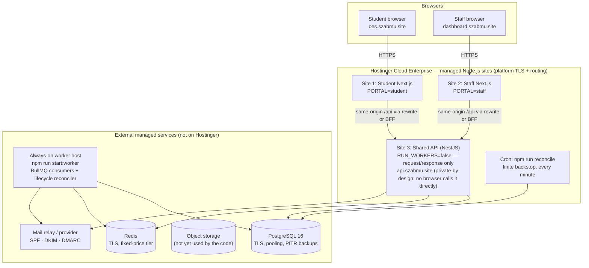

# 02 — Deployment architecture (managed hosting + external services)

## Topology (recommended: A)

## What runs where

| Component | Where | Why |
|---|---|---|
| Student UI, Staff UI | Hostinger Node.js sites (Next.js 16) | Request/response only |
| API (auth, exam delivery, results, control) | Hostinger Node.js site, `RUN_WORKERS=false` | Request/response only; **no timers inside the web process** |
| Lifecycle reconciler + BullMQ consumers | **External always-on worker** (`apps/api/src/worker.ts`) | Hostinger does not run permanent background processes |
| Finite reconciliation backstop | Hostinger cron (`apps/api/src/cron/reconcile.ts`) | Optional safety net; **not** a deadline mechanism (doc `cron-limitations.md`) |
| PostgreSQL | External managed service | Hostinger offers MySQL only; the engine depends on PostgreSQL |
| Redis | External managed service | Hostinger offers none; classification in doc 05 |
| Object storage | External, **future** | The code has `S3_*` settings but no upload/serving path yet |

## Options when Node.js slots are short (blocker B-01)

| Option | Hostinger slots | Change | Trade-off |
|---|---|---|---|
| **A** three sites (above) | 3 | none | cleanest isolation; needs 3 free slots |
| **B** one host-aware Next.js site answers both hostnames (parked domain) + API on a site | 2 | portal chosen from the request `Host` instead of the `PORTAL` variable (small change in `proxy.ts`) | one process serves both portals: a crash or deploy affects both; cookies are still host-only per hostname |
| **C** B + the API on the external worker host | 1 | API deployed beside the worker | most Hostinger-light; API leaves managed hosting; its availability is then the external host's |

Recommendation: **A** if three slots can be made available by decision of the account owner; otherwise **B**. C only if the external host is chosen to be production-grade anyway.

## Same-origin rule (no CORS)

The browser only ever calls its own origin's `/api/…` (`apps/web/src/api.ts`, CSP `connect-src 'self'`). The portal server forwards to the API. Two ways, **neither verified on Hostinger**:

1. **Next.js `rewrites`** (existing: `next.config.mjs`, destination `API_INTERNAL_URL`) — zero new code, e2e-proven locally, but it cannot add request headers; the API then identifies the portal from the forwarded `Origin` (login and state-changing requests always carry it).
2. **A BFF route handler** that forwards the request and adds `X-OES-Portal` plus an HMAC the API verifies — stronger, more code, every API byte (including SSE) passes through the web process.

Doc 06 specifies both and the staging test that decides.

## Preserved unchanged
Exam engine (revisioned idempotent saves, server clock, immutable sealed answers), the database-lease lifecycle reconciler, audit chain, scoring and publication workflow, `productionProblems` config gate, metrics.
