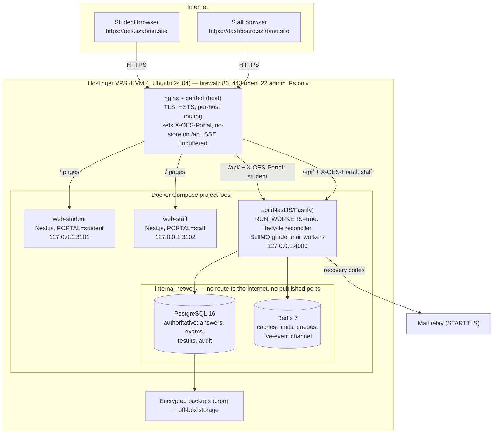

# 03 — Two-portal architecture

## Decision

**Option A — the existing Next.js application, built once, run as two role-restricted frontend processes** (`PORTAL=student` and `PORTAL=staff`), both talking to the **one** existing API, database and exam engine. Nothing is duplicated.

### Why A, from the repository's facts

| Fact | Consequence |
|---|---|
| `apps/web` is one app whose pages already split cleanly by role: candidate-only pages call `/me/*` endpoints and print "This page is for candidates" otherwise (`results`, `schedule`, `performance`, `certificate`, `exam`); staff pages are the rest (`nav.ts`). | A path allow-list per portal is complete and small (`packages/shared/src/portal.ts`, tested). |
| The browser only ever calls same-origin `/api/…` (`src/api.ts`); CSP is `connect-src 'self'`; CSRF uses an Origin allow-list (`WEB_ORIGIN` accepts several); the cookie is host-only. | A proxy-per-hostname that forwards `/api/` to the same API needs **no frontend change** and keeps everything same-origin. |
| The backend already authorises every route by permission (`@Perm`, deny by default) and scopes data by institution. | Portal binding is an *extra* boundary on top, not the primary one. |
| Separate frontend apps (B) would duplicate `ui.tsx`, `api.ts`, the exam engine and the auth pages, and the other session is actively changing them. | Rejected: guaranteed drift. |
| Host-aware single process (C) would have to trust the `Host`/forwarded header inside Next to decide what to serve. | Rejected for the web tier: with A the restriction comes from process configuration, not a header, and the two portals restart/deploy independently. |

### What is shared and what is separate

| Shared (one of each) | Separate per portal |
|---|---|
| PostgreSQL database, Redis, API process (+ lifecycle reconciler), Prisma migrations, exam engine, audit chain, institution/campus data, results | public hostname + TLS certificate · Next.js process (`PORTAL=…`) · nginx vhost · `X-OES-Portal` value · cookie jar (host-only) · access log |

## Diagram

## Processes and resources (KVM 4: 4 vCPU / 16 GB)

| Process | Role | Starting budget |
|---|---|---|
| postgres | authoritative store | `shared_buffers` 3 GB, `effective_cache_size` 8 GB, `max_connections` 200 |
| api | all business logic, one process (lifecycle lease makes a second replica safe later) | `DB_POOL_MAX=20`, ~1–2 GB |
| redis | accelerators | `maxmemory 512mb`, `noeviction`, AOF |
| web-student / web-staff | page serving only | ~300 MB each |
| nginx | edge | small |

## Existing services to preserve (unchanged)

API, exam engine (revisioned saves, idempotent submit, server clock), lifecycle reconciler, PostgreSQL schema and triggers, Redis roles, audit chain, backup/restore tooling, metrics and alert rules, `productionProblems` config gate, seed refusal in production.

## Required frontend changes
- **Done in this branch (default off):** `apps/web/src/proxy.ts` serves only a portal's own pages when `PORTAL` is set; anything else gets the branded 404.
- Later (not started): a build/runtime check that every page in `nav.ts` is covered by the portal lists; no further UI change is needed for same-origin proxying.

## Required backend changes (details in doc 08)
- **Done in this branch (default off):** `PORTAL_ENFORCE` — role↔portal check at sign-in and on every authenticated request; required in production.
- Still required: first-admin bootstrap (G1), SMTP authentication or relay (G3), `Cache-Control: no-store` on authenticated responses (G5), require `Origin` on state-changing requests (G6), `__Host-` cookie name (G10), fix/remove `npm run worker` (G2).
